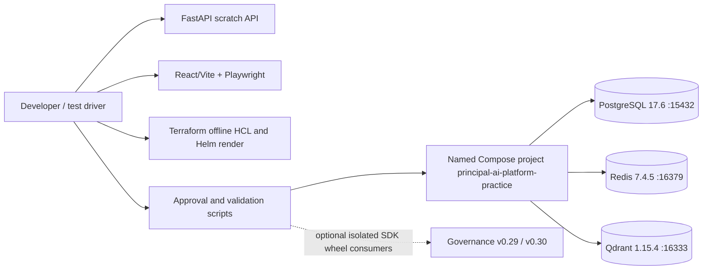
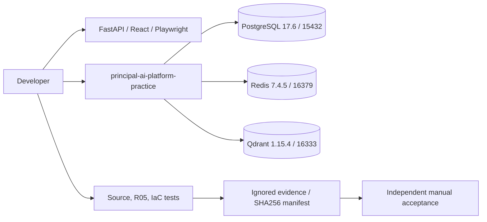

# Architecture — isolated Principal AI Platform practice stack

All service host ports bind to `127.0.0.1`; this is not zero-trust network isolation or production hardening. PostgreSQL uses an environment-provided password, Redis an ACL file (with broad local test privileges), and Qdrant an API key. Container/host administrators can inspect configured secrets. `create_env.sh` generates private credentials per clone; none are bundled.

## Trust boundaries

- **Host:** Node1 Docker group is root-equivalent; no global Docker changes or volume prune.
- **Practice project:** Compose `name` isolates control plane identity from other Docker stacks; named volumes hold state and are not deleted.
- **Application:** Python and React scratch clients test local behavior only, not production auth/RLS/OIDC.
- **SDK:** R05 compares isolated wheels and bounded fail-closed behavior; not equivalent to independent M30 production governance or external evidence.
- **Evidence:** logs and SHA manifests stay outside version control; reviewer authorizes acceptance separately.

## ADRs and deliberately deferred work

ADR-001: choose loopback-only Docker Compose for reproducible practice, rather than system-wide PostgreSQL/Redis installations. Trade-off: not equivalent to HA Kubernetes.

ADR-002: retain vendored source, lockfile and code-backed tests in Git; exclude binary wheels/venvs/state. Trade-off: fresh builds need approved package registries and version drift review.

ADR-003: do not modify historical Governance/Form 8825 repos; use tagged snapshots and separate virtualenvs for cross-version tests. Trade-off: original working tree has unresolved source limitations.

Future phases: R03 OpenAPI cross-version clients, R09 RLS/tenant denial, R10 idempotency and tenant-filtered vectors, R06/R07 governed agents, R11–R13 identity/OTel/CI, and remaining principal-engineering drills.

## Verified Node1 runtime and baseline boundary

Node1 Docker Engine 29.5.1 was stopped and recovered. Compose `start` reused existing containers/volumes; Docker unrelated CCTV containers were deliberately not modified. This is loopback practice isolation, not enterprise tenancy, OIDC, HA or production release qualification.

## Verified baseline reference

[Baseline qualification checkpoint](baseline_qualification_checkpoint.md) records the dated Node1 evidence, dependency boundaries, outstanding engineering gates and fresh-machine acceptance limitations.
