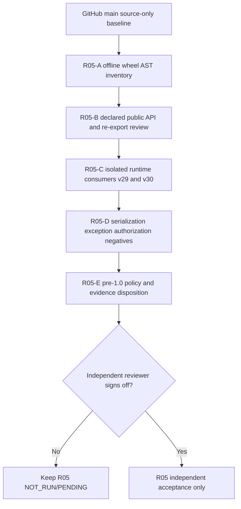

# R05 Extended SDK Compatibility — Engineering Specification

**Scope:** `ai_platform_setup_v3`, after approved GitHub baseline `main` merge `3f429aacb889f55521671cb013a73ed5550d90be` (2026-11-14). **State:** R05-A executed on Node1: 2 comparator tests passed, both seven-case consumer suites passed, and the wheel AST comparison reported six additive modules with no other detected declaration changes. R05-B/C/D/E and independent acceptance remain **NOT RUN/NOT APPROVED**.

## 1. Baseline and provenance

- Historical artifact: Governance v0.29.0 wheel, derived from historical annotated `m29-enterprise-cross-domain-validation-v0.29.0` tag and built as a separate artifact.
- Candidate artifact: corrected v0.30.0 wheel from the **snapshot**, not a release from the original Governance repository.
- Existing `tests/r05/test_shared_contract.py` implements 7 isolated, deterministic tests per installed consumer, covering installation provenance, state, budgets, HMAC integrity, nonce replay, authorization and selected dataclass serialization.
- Historical v0.29.0 package has `__version__ = '0.21.1'` even though the distribution metadata is `0.29.0`; this is a provenance discrepancy, not an instruction to rewrite an immutable historical tag.
- No SDK wheels, original source trees or consumer venvs belong in this repository.

## 2. Engineering boundaries



The compatibility auditor **does not import or execute wheels**. The report is discovery evidence only. It compares top-level public candidates, class/instance methods including `__init__`, AST parameters and annotations/defaults, class annotated attributes, import aliases, star-import declarations and static `__all__` assignments. It cannot resolve star exports, inherited members, generated dataclass constructors, runtime monkey patches, exception effects, or JSON compatibility. `__all__` is detected only when statically evaluable.

## 3. R05-A — wheel-inventory execution

From a feature branch under the `ai_platform_setup_v3` checkout:

```bash
set -Eeuo pipefail
ROOT="$(git rev-parse --show-toplevel)"
# Set these to the reviewed existing wheel files outside this repository:
: "${R05_OLD_WHEEL:?Set historical 0.29.0 wheel path}"
: "${R05_NEW_WHEEL:?Set corrected 0.30.0 wheel path}"
mkdir -p "$ROOT/reports/r05-extended"
python3 "$ROOT/scripts/qualification/audit_r05_public_api.py" \
  --old "$R05_OLD_WHEEL" --new "$R05_NEW_WHEEL" \
  --output "$ROOT/reports/r05-extended/api_ast_delta.json"
python3 -m pytest -q "$ROOT/tests/r05/test_public_api_inventory.py"
```

Preserve both wheel SHA-256 fingerprints, `pip check` of consumers and the exact comparator version/commit. Store outputs only in ignored `reports/`. Any removed/changed declaration is **review required**, even on a pre-1.0 SDK.

## 4. R05-B — declared public surface

Start with documentation and package `__init__.py` rather than assuming all symbols without underscores are guaranteed API. Review:

1. Documented import examples, exported `__all__`, direct re-exports, star imports, deprecated aliases and re-export identity.
2. Class and instance methods: positional-only/keyword-only boundaries, defaults, abstract/staticmethod/classmethod decorators, sync/async and exception behavior.
3. Dataclasses: field names/order/types/default factories, constructors, `asdict`, `as_dict`, JSON serialization, frozen semantics, tuple vs list normalization, unknown keys and schema version handling.
4. Security contracts: deny precedence, missing role/tenant, failed signatures, truncated/tampered payloads, replay and malformed cache states.
5. Exceptions: concrete type, inherited type where documented, stable machine-readable error code if any, and absence of sensitive values in messages.

Output `reports/r05-extended/public_api_scope.md` with **documented/supported**, **internal**, **uncertain** classifications and reviewer rationale; avoid inferring official support from static syntax.

## 5. R05-C/D — runtime consumers

Run identical tests in independent v0.29.0 and v0.30.0 wheel-installed virtual environments (outside both source trees), with explicit `GOV_EXPECTED_VERSION` and import origin under `site-packages`. Keep historical shared suite unchanged; new tests should target only explicitly supported common behavior and must not silently skip unimplemented APIs. For intentional new v0.30.0 functionality, add separate tests labelled `NEW_030_ONLY`, not cross-version regressions.

Use a normalized schema fixture for deterministic `dataclasses.asdict` and JSON output; confirm serialization output contracts before selecting `tuple` or `list` as requirements. Generate refusal/negative test matrices (tamper, replay, missing authorization, malformed input) and compare *types and observable results* rather than fragile exception wording unless documented.

## 6. R05-E — pre-1.0 version policy (PROPOSAL; requires owner approval)

Semantic Versioning 2.0.0 describes `0.y.z` as initial development that may change at any time; it does **not** establish a backwards-compatibility guarantee. Python packaging version identifiers and version-specifier semantics are separately governed by the Python Packaging specifications. `0.29.0` → `0.30.0` is a minor-number transition during pre-1.0 development; no automatic consumer compatibility guarantee follows.

Proposed local policy: explicitly designate supported public imports and schemas; treat removals and behavioral changes as review-blocking until documented, regardless of pre-1.0 status; document old SDK consumers and a migration window; maintain independent release authorization separate from this preparation project. Do not claim this proposal is the existing Governance project's policy until its maintainers approve it.

Historical metadata `__version__` inconsistency must be reported separately. Do not mutate the historical v0.29.0 tag or infer that its wheel is an approved production release.

References: <https://semver.org/spec/v2.0.0.html>; <https://packaging.python.org/en/latest/specifications/version-specifiers/>.

## 7. Acceptance and stop conditions

| Gate | Evidence required | Current decision |
|---|---|---|
| A Static inventory | Wheel digests, AST diff, comparator self-tests | Analyst fixture PASS, Node1 rerun pending |
| B Public API classification | Documented exports, re-exports, method contract review | NOT RUN |
| C Dual-wheel runtime | Same expanded contracts in both isolated environments | 7 historical tests PASS; expansion NOT RUN |
| D Behavioral negative cases | Serialization, exception, authorization/refusal and replay evidence | PARTIAL historical tests only |
| E Version policy | Maintainer-approved pre-1.0 contract and breaking-change disposition | NOT APPROVED |
| G1 Independent acceptance | Independent reviewer and evidence audit | NOT RUN |

**Do not update** `requirements_evidence_gap_drills.csv` to `PASS`, issue a production tag, merge Governance work, or authorize M30 release based on phase A.

## 8. Follow-on order

After R05 reaches independent acceptance: R03 OpenAPI compatibility → R09 PostgreSQL RLS/tenant denial → R10 Redis/Qdrant reliability and tenant filtering → R06/R07 evaluated RAG and governed agents → R11–R16 identity, telemetry, CI/CD, architecture and delivery evidence.


## Node1 execution evidence

[Node1 R05-A evidence reconciliation](R05_NODE1_AUDIT_20261114.md) records the actual executed static comparison, wheel fingerprints and outstanding acceptance gates.
